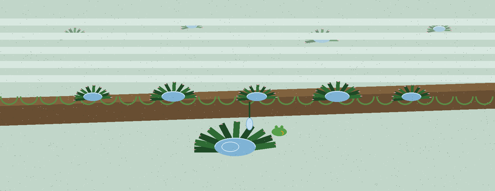

# crypto-password-generator

Title block: the name above is set in Biryani in deep leaf green on a pale specimen sheet, ruled beneath in leaf green like a herbarium sheet heading, with a small bromeliad rosette drawn once at the left of the first heading only.


> Collector note, entered under the sheet: rain first, then the cup, then the keeping, each step in sequence.


## **Technical Documentation for Security Analysis Tool**

> Collector note, in a plain hand: what is gathered here is held briefly, in the open, and stored nowhere.


### **1. Tool Overview**

**Tool Name:** `crypto-password-generator`

**Category:** Cryptography

**Overview:**

`crypto-password-generator` is a command-line tool that generates random, secure passwords. It utilizes core cryptographic operations for password generation.

> Collector note, at the foot of the sheet: the cup holds sixteen bytes of fresh rain whatever length of string is asked for.


### **2. Analysis Purposes**

The tool is designed to assist in the creation of strong and secure passwords, mitigating the risk of password compromise. It does not focus on comprehensive security analysis but rather provides a specific utility for password generation in a secure manner.

### **3. Installation Steps**

There is no pip package for this tool. Clone the repository and install the one dependency:

```
git clone https://github.com/ShadowGuard-AI/crypto-password-generator.git
cd crypto-password-generator
pip install -r requirements.txt
```

### **4. Usage Examples**

```

# Basic usage: Generate a 16-character password
python3 main.py

# Specify password length
python3 main.py --length 24
```

**Safeguards:**

- Passwords are generated using a cryptographically secure pseudo-random number generator (CSPRNG) to ensure randomness and unpredictability.
- Users can specify the desired password length to meet specific security requirements.
- The tool does not store or share the generated password, minimizing the risk of compromise.

### **5. Implementation Details**

**Core Functions:**

- `setup_argparse()`: Sets up command-line argument parsing for specifying password length (`-l` / `--length`), a custom salt (`-s` / `--salt`), and the PBKDF2 iteration count (`-i` / `--iterations`), plus `-v` / `--version`. There is no saving option: the generated password is printed to the console and is not written to a file.
- `main()`: Implements the core functionality of password generation.

**Security Features:**

- **CSPRNG:** The random material comes from the Python standard library `secrets` module (`secrets.token_bytes`, at main.py lines 63 and 78), not from the `cryptography` package. The `cryptography` package provides the PBKDF2-HMAC-SHA256 key derivation that stretches that random material.
- **Password Complexity:** The password is the derived key encoded as URL-safe base64 and cut to the requested length, so its characters are letters, digits, `-` and `_`. It does not add symbol classes beyond that alphabet. The exit code is 1 when generation fails (for example a length or iteration count below 1).
- **No Storage or Sharing:** The generated password is not stored or shared anywhere, eliminating the risk of accidental disclosure or compromise.

### **6. License and Compliance Information**

**License:** GNU General Public License v3.0 (GPL-3.0). See the LICENSE file in this repository.

**Compliance:**

- Complies with best practices for password security and randomness.
- Meets industry standards for generating secure passwords.


## Keeper facts, stated from the code

### The making, in working order

Fresh random material is drawn from the Python standard library secrets module by the token bytes call, once for a random salt when no custom salt is supplied and once for the material fed to the key derivation. That material is stretched through PBKDF2 with HMAC and SHA256, as provided by the cryptography package, for a count of iterations that defaults to one hundred thousand. The derived bytes are encoded as URL safe base64, cut to the requested length and printed to the console under a fixed printed label, after which nothing is kept, written to a file or sent anywhere.

### Every control, in parser order

The length option, short l, long length, sets the character count and defaults to sixteen, with any value below one ending the run at exit 1. The salt option, short s, long salt, accepts a custom salt as text, which the code encodes before use, and defaults to no custom salt, in which case a fresh random salt of sixteen bytes is drawn instead. The iterations option, short i, long iterations, sets the PBKDF2 count, defaults to one hundred thousand and likewise ends the run at exit 1 when set below one. The version option, short v, long version, prints the tool name with its version number and stops. No saving option exists in the parser at all.

### The character facts, by rule only

The printed result can contain letters, digits and the two URL safe base64 marks, hyphen and underscore. It adds no symbol class beyond that alphabet. The padding marks of base64 never appear in the printed result, because they sit past the cut even at the shortest lengths. No example result is shown anywhere in this re-skin, in line with the secrets rule for this repo.

### The limit stated in the code comments

A long request does not carry more fresh randomness than a short one, because the token behind the derivation is sixteen bytes whatever length was asked for, so the derivation stretches those bits across more characters without creating entropy the inputs did not hold. A custom salt changes the outcome yet never makes it repeatable on its own, because the second token is drawn fresh on every run.

### The licence

The licence is the GNU General Public License v3.0, held in full in the LICENSE file.
